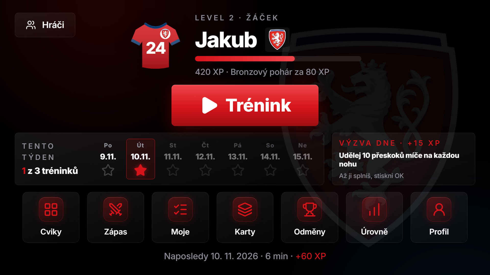
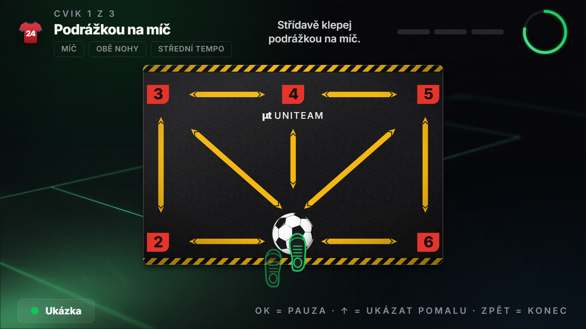
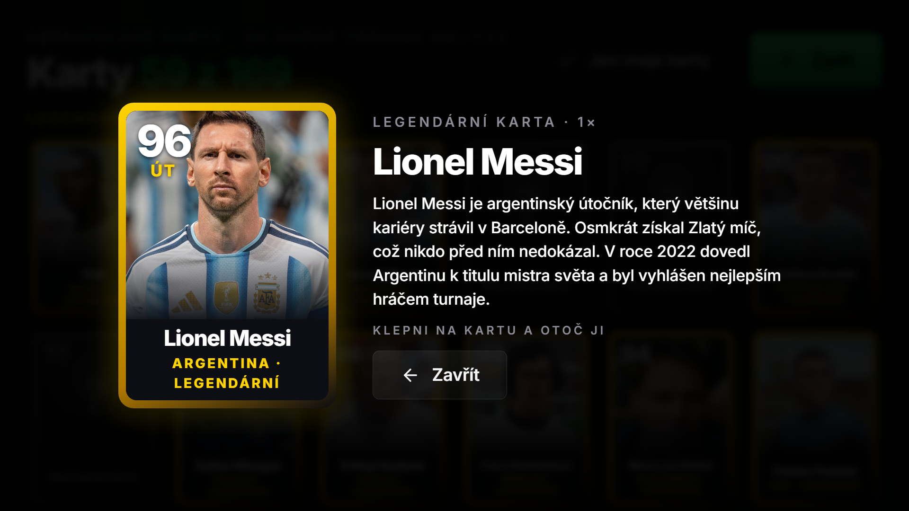
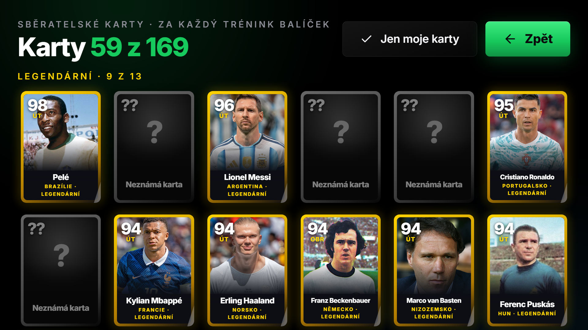
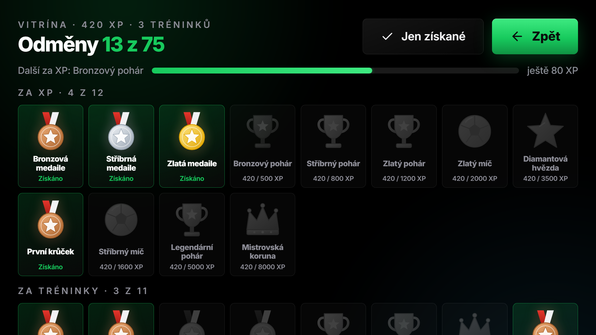
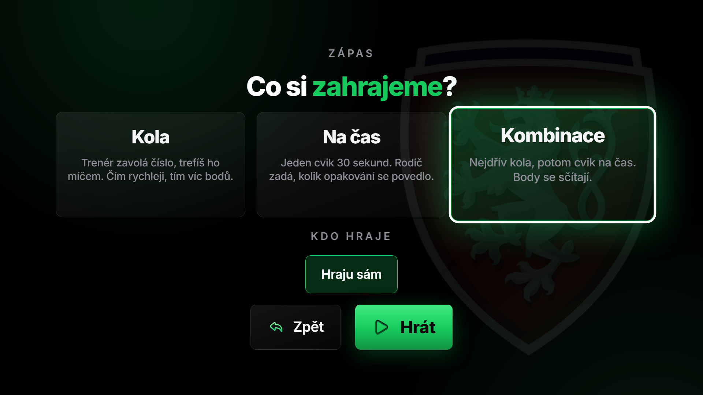
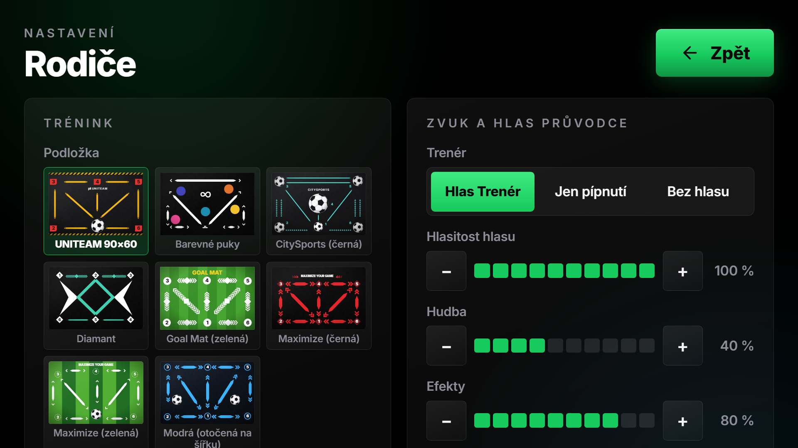

<div align="center">

# ⚽ Tréninková podložka

**Fotbalový trénink s podložkou pro děti. Na TV, tabletu, telefonu i v prohlížeči.**

Trenér hlasem říká, kam s míčem, hráč sbírá hvězdy, odměny a sběratelské karty slavných fotbalistů.


<a href="https://kuba-uhlir.github.io/treninkova-podlozka/?demo"></a>

<br><br>

<a href="https://kuba-uhlir.github.io/treninkova-podlozka/?demo"></a>

</div>

---

## ▶ Vyzkoušejte hned

> **[Otevřít demo](https://kuba-uhlir.github.io/treninkova-podlozka/?demo)**: v prohlížeči, bez instalace a bez registrace.

Odkaz vytvoří hotového ukázkového hráče **Jakuba** (číslo 24, česká reprezentace) s trochou postupu, takže si můžete rovnou projít týdenní lištu, odměny, sběratelské karty i zápas. Spusťte **Trénink**, nechte si říct, kam s míčem, a postavte podložku před obrazovku.

- Všechna data zůstávají jen ve vašem prohlížeči a nikam se neodesílají.
- Pokud už v prohlížeči nějaké hráče máte, demo je nepřepíše.
- Zvuk se spustí po prvním klepnutí na stránku.

## Co aplikace umí

| | |
|---|---|
| 🎯 **Trénink s Trenérem** | Ukázka cviku, odpočet 3‑2‑1 a hlasové povely podle zón podložky. Trenér řekne, co se bude dělat, takže nemusí umět číst ani pětileté dítě. |
| 🦶 **37 cviků ve 4 úrovních** | Od jednoduchých přitažení míče po Twister s nohama a přeskoky. Tempo se samo přizpůsobí úrovni, hlavní noha dostává většinu cviků a slabší jen občas. |
| 🧩 **Podložky podle vzhledu** | 8 podložek s detailní simulací včetně barevných variant. Míč a plánovaný směr se zvýrazňují přímo na podložce. |
| ⚔️ **Zápas** | Kola podle hlasu, cvik na čas s rekordy nebo obojí. Hraje se sám, nebo se dva hráči střídají. |
| 🃏 **Sběratelské karty** | 169 slavných fotbalistů ve čtyřech vzácnostech, s fotkami z Wikimedia Commons. Karta se otáčí a na rubu je zajímavost, vedle ní je popis hráče. |
| 🏆 **75 odměn** | Medaile, poháry, koruny a další za XP, tréninky, pravidelnost, dovednosti, zápasy i karty. |
| 📅 **Týden a výzva dne** | Týdenní lišta s hvězdičkami, denní mini‑výzva a rozcvička jednou denně. |
| 👨‍👩‍👦 **Rodiče** | Úroveň a tempo nastavuje rodič, vlastní tréninky, výběr podložky a barvy, hlas nebo jen pípnutí. Chráněno PINem. |
| 📺 **10‑foot UI** | Ovládání dálkovým ovladačem (D‑pad), velké prvky, tmavý moderní vzhled. Funguje i dotykem a myší. |
| 🔒 **Bez účtů a cloudu** | Všechna data jsou jen v zařízení. Žádné reklamy, žádné sledování. |

## Instalace (pro rodiče)

| Chci… | Návod |
|---|---|
| **vyzkoušet hned** v prohlížeči | otevřít [webovou verzi](https://kuba-uhlir.github.io/treninkova-podlozka/) nebo [demo s hotovým hráčem](https://kuba-uhlir.github.io/treninkova-podlozka/?demo) |
| **Android telefon nebo tablet** | stáhnout `treninkova-podlozka.apk` z [Releases](https://github.com/kuba-uhlir/treninkova-podlozka/releases) |
| **Android TV** | APK přes aplikaci Downloader nebo USB, viz návod |

Podrobný postup krok za krokem je v **[docs/INSTALL.md](docs/INSTALL.md)**.

## Ukázky

<table>
  <tr>
    <td><br><sub>Trénink: míč a směr přímo na podložce</sub></td>
    <td><br><sub>Sběratelská karta s popisem hráče</sub></td>
  </tr>
  <tr>
    <td><br><sub>Album karet</sub></td>
    <td><br><sub>Vitrína odměn</sub></td>
  </tr>
  <tr>
    <td><br><sub>Zápas: kola, na čas, kombinace</sub></td>
    <td><br><sub>Rodiče: výběr podložky, barvy a hlasu</sub></td>
  </tr>
</table>

## Rychlý start

Potřebujete [Node.js](https://nodejs.org) 18 nebo novější.

```bash
git clone https://github.com/<vas-ucet>/<repo>.git
cd <repo>
npm install
npm run dev          # http://localhost:5173
```

### Jako web

```bash
npm run build        # hotová stránka v dist/
npm run build:web    # varianta, která jde otevřít i ze souboru (Fotbal-web/index.html)
```

### Jako Android / Android TV aplikace

Potřebujete JDK 17+ a Android SDK.

```bash
npm run cap:sync
cd android
./gradlew assembleDebug     # APK: android/app/build/outputs/apk/debug/app-debug.apk
```

> Na Windows s diakritikou v cestě staví Gradle přes ASCII alias disku, viz [`docs/ANDROID.md`](docs/ANDROID.md).

## Jak to funguje

```
src/
├─ screens/     obrazovky (domů, přehrávač, zápas, karty, odměny, rodiče …)
├─ ui/          komponenty: podložka (SVG), karty, ikony, dres, téma
├─ domain/      logika: trénink, XP, odměny, karty, týden
├─ config/      podložky (JSON) a týmy
├─ content/     cviky, hlášky Trenéra, karty hráčů, popisy
├─ core/        router, ovládání D‑padem, zvuk
└─ storage/     lokální databáze (IndexedDB)
assets/         obrázky, hlasy a zvuky
scripts/        generátory (hlasy, karty, podložky, ikony, snímky)
```

### Přidání další podložky

1. Zkopírujte [`src/config/mats/uniteam-90x60.json`](src/config/mats/uniteam-90x60.json) a změňte `id` a `name`.
2. Upravte `zones`, `badges`, `arrows` (souřadnice ve `viewBox` 150×100) a vzhled v `skin` (barvy, styl šipek, pruhy trávníku, tvar čísel).
3. Barevná provedení přidejte do `variants`. Podložka se sama objeví v **Rodiče → Podložka**.

Hotové ukázky jsou v [`scripts/make-mats.mjs`](scripts/make-mats.mjs) a [`scripts/make-mat-diamond.mjs`](scripts/make-mat-diamond.mjs).

### Skripty pro vývojáře (nepovinné)

K **instalaci ani spuštění aplikace nepotřebujete nic stahovat**: fotky karet, hlasy, popisy hráčů i podložky jsou už součástí repozitáře. Skripty slouží jen k tomu, aby šly tyto soubory znovu vytvořit nebo rozšířit.

| Příkaz | Co dělá |
|---|---|
| `node scripts/gen-voices.mjs && node scripts/trim-voices.mjs` | znovu vygeneruje a ořízne hlasové hlášky Trenéra |
| `node scripts/fetch-cards.mjs` | znovu stáhne fotky karet z Wikimedia Commons včetně autorů |
| `node scripts/make-mats.mjs` | znovu vygeneruje JSON podložek |
| `node scripts/build-icons.mjs` | složí ikony z balíčku Lucide |
| `node scripts/screenshots.mjs` | pořídí snímky obrazovek do `docs/screenshots` |

Popisy hráčů jsou v [`src/content/players.json`](src/content/players.json), zajímavosti na rubu karet v [`src/content/facts.json`](src/content/facts.json). Obojí lze přímo upravovat.

## Licence a zdroje

Zdrojový kód je pod licencí [MIT](LICENSE). Obrázky, fotky, hlasy a loga mají vlastní licence a podmínky. Úplný přehled včetně autorů fotek je v [`LICENSES.md`](LICENSES.md) a přímo v aplikaci (Rodiče → O aplikaci a licence).

Aplikace není nijak spojená s uvedenými kluby, hráči, svazy ani výrobci podložek. Jména, loga a fotky slouží pouze k označení a k nekomerčnímu vzdělávacímu použití.

---

<div align="center">

Vytvořil **Jakub Uhlíř** pro malé fotbalisty. ⚽

</div>
